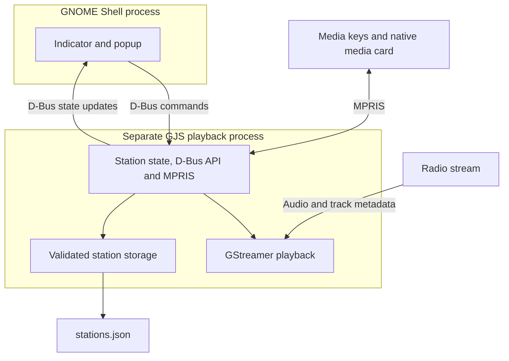

# radiolina

A lightweight internet radio indicator for **GNOME Shell 49**. Click its top-bar
icon for a native popup with play/pause, saved stations, and an inline add/edit form.
The compact information box shows the station name, available song
title and artist together as **Artist — Title**, and play/pause. The station name
is bold; track information is smaller and subdued, following the theme's text color.
Below the divider,
**Recent** shows the last three unique stations that actually played, newest first.
Set its visible count from **1–10** in Settings; the default is **3**.
The full saved list starts collapsed; use the arrow beside **Stations** to expand it. The toolbar
also has Search, **+**, and Settings buttons. Media controls are exported through MPRIS.

The permanent extension identifier is `radiolina@drdaniloromano.github.io`.
Existing `gnome-radio` configuration and cache paths preserve saved stations and
preferences when switching from the development installation.

Source: [radiolina-ext](https://github.com/drdaniloromano/radiolina-ext).
Report problems through [GitHub Issues](https://github.com/drdaniloromano/radiolina-ext/issues),
including your GNOME Shell version and steps to reproduce the problem.

The panel icon shows **signal marks while playing** and a **plain radio while
paused or inactive**. Both symbols inherit the theme's foreground color. Connecting,
stopped, and failed playback use the inactive symbol. Both icons are static;
playback status is shown by the signal marks, without animation.
The top-bar icon has no extra padding or margins while retaining native button
padding and icon sizing.
radiolina uses its own panel button and popup by default. In Settings, **Group with
other app indicators** is **off by default**. Its warning reads:

> Grouping may be incompatible with some extensions or panel customizations. Disable this option if icons, menus, or clicks behave unexpectedly.

Enabling the preference requires an explicitly supported cooperative host.
No host integration is currently shipped, so radiolina stays separate and shows
**No supported indicator group is available. radiolina stays separate.** It does not
inspect, move, restyle, or change input handling for other extensions' indicators.

The indicator and popup controls use GNOME Shell's standard styles, including
`system-status-icon`, `icon-button`, and native text buttons. Saved stations use standard Shell
menu rows showing station names in regular weight. A small play/pause/stop icon
marks the selected station, with **(playing)** only during active playback; no
checkbox or selection dot is shown. Section headings are bold, with a separator
above Stations. Recent entries can start playback directly;
stream URLs are available through the editor and its Copy action. Fonts, colors, borders, and
button states and icon sizes follow the active GNOME Shell theme. Compact padding
on the edit/search/add buttons and list rows saves space; the infobox uses tighter
spacing while the play/pause control keeps its standard size.
The divider above Stations has equal clearance from the last Recent row's action
icons and the Stations action icons. Opening search keeps the toolbar height and
padding unchanged. Search, Name, and URL use the same compact native entry styling.
Search matches the action-button height and stays vertically centered when shown.
The popup keeps a fixed width across search, settings, forms, and metadata changes.
The infobox also keeps a fixed height: the name centers alone and moves up to make
room for track information when available. Its height follows the theme's font
size; the text column uses the remaining width so long metadata cannot push the
play button out of the popup. Errors appear separately below it.
The infobox has a fixed order: **Play/Pause | Stop | station/track info | Quit**.
Stop closes the stream and exits the playback service while keeping the indicator
and saved stations available. Play starts a fresh service and reconnects to the live
stream. Editing stations or changing settings also starts the service on demand.
**Add/Edit**, **Settings**, and the expanded **Stations** list share one area:
opening one replaces the others. Search opens the Stations view. The infobox and
Recent section remain visible. All widgets inherit GNOME's current light/dark theme.
Station selection, list actions, playback, settings switches, and form buttons keep the popup
open. Dismiss it with Escape, a click outside, or another click on the indicator.
The power icon at the right of the infobox is **Quit**. It stops playback and removes
radiolina from the panel, preserving saved stations and preferences. There is no bottom
Quit row. To reopen radiolina, run
`gnome-extensions enable radiolina@drdaniloromano.github.io` or enable radiolina in Extensions.
There is no additional GUI framework or clipboard dependency. GNOME's notification
center keeps its native media card with title, artist, and play/pause controls.
It updates in place without song-change popup banners or notification sounds.

The extension currently uses GNOME's default `user` session mode. GNOME disables
it when the screen locks, which stops the service and playback. Unlocking enables
it again with saved stations loaded; playback does not resume automatically.

## Development without host dependency installation

Use existing Podman and Make:

```sh
make container-build
make container-test
make container-package
```

Development packages are installed **inside the Fedora 43 image only**. Tests run
with external networking disabled, a read-only source mount, temporary XDG paths,
a private D-Bus session, a local generated MP3/ICY server, and a silent audio sink.
No Python/npm packages or GNOME extensions are installed on the host. The package
is written to `build/radiolina@drdaniloromano.github.io.zip`.

If the required tools are already present, `make build` and `make test` work
locally without installing anything. Runtime needs GJS 1.86, GLib/Gio (including
GLibUnix), GStreamer 1.26 with base/good plugins, libsoup 3 for playlists/optional
favicons, and a working desktop audio sink.
Tests additionally need Python 3, PyGObject, `dbus-run-session`, and `gst-launch-1.0`.
Other runtime versions are not yet verified.

## Desktop verification

`make test-shell` exercises the actual extension inside a disposable headless
GNOME 49 Shell: real ZIP installation/replacement and uninstall preserving saved
data, station form validation, readable native text, saved-station search,
playback, song/artist updates in the native media card, absence of song-change popups
even with an old enabled preference, recent stations, collapsed-list controls,
favicon settings, persistence, and disable/re-enable cleanup. It uses
an isolated test-only bootstrap for evaluator access; that bootstrap is never
packaged. Logs go to ignored `workspace/shell-e2e.log`.

This requires an already installed GNOME 49 Shell and usable rendering backend.
Prefer a disposable GNOME VM for full visual/audio/media-key checks. The private
test bus deliberately cannot activate host desktop services. A headless Shell is
process/settings isolation, not a full VM or security sandbox.

## Try the built package

Only when ready to install into your own GNOME 49 session:

If you previously installed the development ID, disable it first:

```sh
gnome-extensions disable gnome-radio@local
```

Wait for its indicator to disappear and playback to stop, then install the new ID:

```sh
gnome-extensions install --force build/radiolina@drdaniloromano.github.io.zip
# Log out and back in if this is a new extension, then:
gnome-extensions enable radiolina@drdaniloromano.github.io
```

Both IDs share `~/.config/gnome-radio/stations.json`, including saved stations,
selection, recent history, and preferences. Keep the old ID disabled; do not run
both installations together. After verifying the new installation, you may remove
the old extension with `gnome-extensions uninstall gnome-radio@local`. Keep the
configuration directory to retain your data. The isolated Shell test covers this
ID transition without logging out.

### First install without logging out (GNOME 49)

If the files are installed but `gnome-extensions info radiolina@drdaniloromano.github.io` reports
that the extension does not exist, load it in the current session using GNOME's
Looking Glass console. Press **Alt+F2**, enter **lg**, and press Enter. Paste this
single line in the evaluator and press Enter:

```js
if (!Main.extensionManager.lookup('radiolina@drdaniloromano.github.io')) await Main.extensionManager.loadExtension(Main.extensionManager.createExtensionObject('radiolina@drdaniloromano.github.io', Gio.File.new_for_path(GLib.get_user_data_dir() + '/gnome-shell/extensions/radiolina@drdaniloromano.github.io'), 2)); Main.extensionManager.enableExtension('radiolina@drdaniloromano.github.io')
```

Press Esc to close Looking Glass. The indicator should appear, and its enabled
setting persists. This uses GNOME 49's internal extension manager; the Shell E2E
test exercises this exact first-install path. It applies to an extension not yet
loaded in the session; replacing already imported code can still require a fresh
Shell session. GNOME's normal D-Bus evaluator remains disabled.

If a previous loading attempt produced a duplicate-indicator error, update the
installed ZIP, then run the recovery helper from Looking Glass. Replace the
checkout path below with the absolute path to this repository:

```js
(await import('file:///path/to/gnome-radio-applet/scripts/live-recover.js')).recover(Main)
```

This removes this applet's orphaned actors, stops its old playback service, and
loads one clean instance. It preserves saved stations and other extensions. The
helper also repairs the icon in an already cached module, so a fresh login is not
needed for that fix. Do not load a second extension object manually.

### Update without logging out

After installing the newly built ZIP, run the updater in Looking Glass, using
your checkout's absolute path:

```js
(await import('file:///path/to/gnome-radio-applet/scripts/live-update.js')).update(Main)
```

Wait for `radiolina updated`, then press Esc. Saved stations are preserved.
The old playback service stops during this update; press Play to resume. The
helper loads a fresh content-addressed UI module to avoid GNOME's JavaScript
cache. Layout styles are versioned too, and startup unloads identifiable older
styles from this applet's own directory. Radio preserves the shared Shell theme
object and leaves other extensions' styles and unidentified registrations alone.
If earlier duplicate loads left unaddressable stale CSS, a fresh Shell session
may be needed for correct styling or light/dark switching on the tested GNOME 49.8.
Radio does not rebuild the shared theme to repair that development-session damage.
Normal login loads the latest module too.

Click **+**, add a station name and its **HTTP(S) audio, M3U, or XSPF URL**, then press Play. A manual
example is `https://stream.nightride.fm/nightride.mp3`; see
[Nightride's stream server](https://stream.nightride.fm/) for current endpoints.
Streams without song metadata still play; the song line stays hidden until a title
is available. The same line includes the artist when supplied by an artist tag or a
conventional combined `Artist - Title` stream field (also en/em dashes). Without
an explicit artist tag, that combined format is interpreted as artist/title; no
external metadata lookup is performed. Artist data also appears in MPRIS and clears
when a new track lacks it. Start typing anywhere in the open popup (outside the
station editor), press **Ctrl+F**, or click **Search** to reveal a native text field
beside **Stations** that expands the full list and filters by name or source URL,
ignoring case. Its clear icon resets the filter; click Search again to hide the
field and restore the unfiltered list. Typing in the station editor edits its fields normally.
The arrow collapses/expands saved stations; closing the popup collapses them again.
Recent history survives restarts, deduplicates repeated plays, and drops deleted
stations. Settings' **Recent stations** minus/plus controls choose **1–10**, default
**3**. The ten latest played stations are retained, so reducing the visible count
does not erase older entries. New installations build history as stations play. This searches your saved list;
online station discovery is deferred.

Open **Settings** (gear) to enable **Fetch station favicons**, off by default.
When enabled, the service requests `/favicon.ico` from each saved stream's origin,
deduplicates hosts, and shows available icons beside station rows and in the infobox.
It does not look up station homepages or use a third-party favicon service. Missing
icons leave the normal text display intact. PNG/ICO downloads run one at a time,
with 256 KiB, image-dimension, three-redirect, and five-second limits. Disabling the
option cancels pending work and hides icons. Cached icons are reused from
`${XDG_CACHE_HOME:-~/.cache}/gnome-radio/favicons/`; no polling or refresh timer runs.

Hover a saved or Recent station row to reveal **Play**, **Edit**, and **Remove**; keyboard focus reveals them
too. Play starts or resumes that station and leaves already playing audio running.
Remove deletes the station from saved stations and Recent; deleting the current
station stops playback. The info box and list rows do not display URLs.
Actions reserve their space so names do not move on hover.
Click the **pencil** to edit the station's name or source URL. The form
is prefilled, with Name taking **30%** and URL **70%** of the available input width
after spacing and the editor's Copy button. Both fields share one row.
The Copy icon beside the URL copies the current field contents without saving or
changing playback. **Save**, **Cancel**, and **Delete** share the next row. Renaming preserves
playback. Changing the playing station's source reconnects; a paused station stays
paused until you press Play. Station IDs, selection, and other stations are preserved.

Ordinary M3U/M3U8 and XSPF playlists resolve to their first usable HTTP(S) entry.
Relative URLs, redirects, XML entities, and CDATA are supported. The original
playlist URL stays saved and displayed. Loading is asynchronous, cancelled on
stop/edit/switch, and bounded to 256 KiB, three playlist levels, five redirects,
and 15 seconds. HLS manifests and XML DTD declarations are outside this support.

Pause suspends the pipeline without recording to disk or allocating a dedicated
time-shift buffer. Resuming can lag the live edge. The infobox Stop button releases
the playback service; MPRIS Stop releases its stream pipeline while keeping the
service available. After the infobox Stop, use Play in the indicator to restart
the service and restore MPRIS/media-key controls. Disabling the extension stops its
service. Media-key routing among multiple players is controlled by the desktop.

Stations, recent history/count, grouping, and the favicon setting live in
`${XDG_CONFIG_HOME:-~/.config}/gnome-radio/stations.json`, with atomic private-file
replacement. Corrupt configuration is reported and preserved for repair. Station
URLs must not include embedded credentials. Source URLs remain available in the
editor and through Copy, and can still be used to filter the saved list.

You can edit this JSON text file manually. Quit radiolina first and back up the file;
then edit the `stations` array, preserving the other settings. Each entry has the
form `{"id":"my_radio","name":"My radio","url":"https://example.com/live.mp3"}`.
Keep IDs and URLs unique; `selected` must name an existing ID (or be empty), and
`recent` may contain only existing IDs. Re-enable radiolina to load the edited file.
Plain text files with one URL per line do not currently have a saved-list importer.
Song changes update the infobox and persistent native media card silently. Open
GNOME's clock/notification center to see the card; it remains while paused and
provides play/pause controls. Existing configuration remains compatible;
legacy notification flags no longer cause desktop popups.

## Architecture and repository layout



The popup sends commands to the service, which owns playback and saved station
state. Service property changes update the interface without polling. GStreamer
runs in the service process; GNOME's media controls use its MPRIS interface.

- `src/core/`: critical validation, bounded playlist/image parsing, and metadata deduplication.
- `src/service/`: playback, async playlist/favicon loading, atomic persistence, D-Bus and MPRIS.
- `extension/`: native Shell popup and bundled symbolic SVGs in
  `extension/icons/`; no decoding inside Shell.
- `tests/unit/`: only critical validation, metadata, and storage tests.
- `tests/e2e/`: real service and Shell tests using local fixtures.
- `scripts/`, `Containerfile`, `Makefile`: contained test/build tooling.

The service starts when the extension is enabled and restarts on demand after
the infobox Stop. Stop, Quit, and disabling the extension end the service. There
are no polling timers, web runtimes, external APIs, or station-directory requests.
The panel icon changes only when playback status changes; it has no animation or timer.
The operational layer contains no Shell widgets; another desktop can use the
same D-Bus contract. No additional desktop adapter is currently shipped.

See [verification and manual checks](docs/TESTING.md), [the implementation plan](docs/IMPLEMENTATION_PLAN.md),
and [changelog](CHANGELOG.md).

## Releases and versioning

The first release is being prepared as **0.1.0**; it has not been published.
Set the user-visible version in `extension/metadata.json` as `version-name`.
Leave the numeric `version` field to extensions.gnome.org; it tracks submissions
separately from our release names. See [GNOME's version metadata documentation](https://gjs.guide/extensions/overview/anatomy.html#version-name).

Use `MAJOR.MINOR.PATCH`: patch increments for fixes and minor increments for new
functionality during `0.x`. Document compatibility breaks and increment the minor
version during `0.x`; after `1.0`, compatibility breaks increment the major version.

Keep changes under **Unreleased** until release checks pass. At release, date the
changelog entry and tag the reviewed commit as `v<version>`, for example `v0.1.0`.
Build the ZIP from that commit and publish its checksum. A version in metadata
does not itself create a tag, publish a release, or submit the extension.

## License

This project's original code, bundled SVGs, documentation, and tooling are licensed
under the [MIT License](LICENSE). The release ZIP includes the same license and
copyright notice; retain them when redistributing copies or substantial portions.

MIT is GPL-compatible. GNOME's [extension review guidelines](https://gjs.guide/extensions/review-guidelines/review-guidelines.html#licensing)
allow MIT-licensed code while requiring distribution under terms compatible with
GNOME Shell's GPL. GNOME Shell and separately installed dependencies retain their
own licenses. See the [provenance review](docs/PROVENANCE.md) for the material
inspected and the limits of that review.

GNOME® is a registered trademark of the GNOME Foundation. This project is
independent and not endorsed by the Foundation. See the
[trademark guidelines](https://foundation.gnome.org/trademark-guidelines/).
