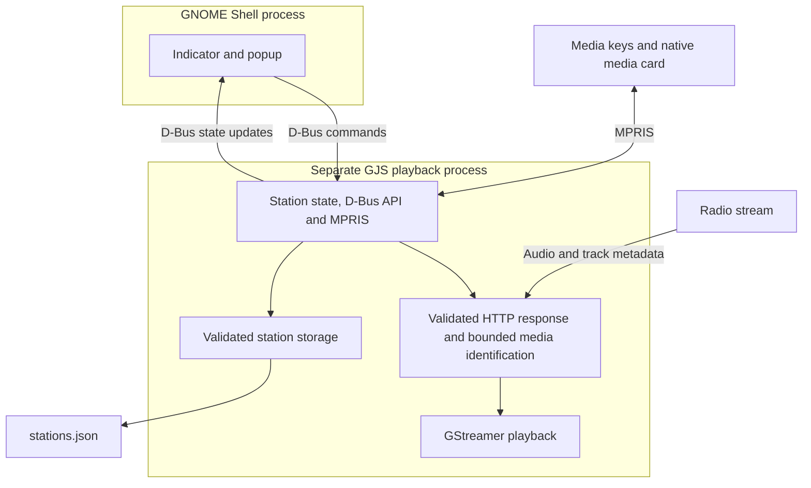

# Development

See [contributor guidelines](../AGENTS.md) and [verification commands](TESTING.md).

## Architecture and ownership



The Shell UI owns widgets, focus, local filtering, and a cached state snapshot.
The separate GJS/GStreamer service owns playback, validation, persistence, source
loading, and metadata. State changes arrive through D-Bus signals rather than
polling. Core logic contains no Shell widgets; no other desktop adapter is shipped.
There is no web runtime, runtime Python/npm dependency, station-directory API,
recording, account system, or podcast subsystem.

| Location | Responsibility |
| --- | --- |
| [extension/](../extension/) | Native popup/indicator, symbolic SVGs, layout CSS, desktop adapter. |
| [src/core/](../src/core/) | URL/config validation, bounded playlist/image parsing, metadata sanitization and deduplication. |
| [src/core/validation/](../src/core/validation/) | Shared URL/redirect rules and bounded byte-level audio/container admission policy. |
| [src/service/](../src/service/) | GStreamer, async playlists/favicons, atomic storage, D-Bus/MPRIS, process-local resource policy. |
| [radio.xml](../src/service/radio.xml) | App command/state contract; `State` is JSON in a D-Bus string property. |
| [tests/unit/](../tests/unit/) | Critical validation, metadata, parsing, and storage cases. |
| [tests/e2e/](../tests/e2e/) | Production service and actual Shell workflows using local fixtures. |
| [scripts/](../scripts/), [Makefile](../Makefile), [Dockerfile](../Dockerfile) | Contained builds, tests, packaging, and live-development helpers. |

### Lifecycle and cancellation

`enable()` loads owned styles, creates the indicator, and starts the service.
`disable()` destroys UI/subscriptions, unloads its stylesheet, and requests service
shutdown without blocking Shell. Service teardown handles SIGTERM/SIGINT and loss
of its owning Shell D-Bus connection. Infobox Stop exits the backend; subsequent
Play or station/settings operations start it on demand. An unexpected service
exit preserves the indicator for explicit retry, with stale metadata cleared.
Screen lock follows GNOME's default `user` session mode: stop on lock, idle on unlock.

UI call generations/cancellables prevent stale replies from updating removed UI
or undoing a newer Stop. Service load generations/cancellables prevent a slow
playlist or obsolete source from starting after a switch, edit, Pause, or Stop.
Track every actor, subscription, timeout, request, and process through its owner
and cleanup path. Keep the focused playback input target intact during a pending
command; the command guard suppresses duplicates without interrupting native gestures.

The two-minute service-readiness deadline accommodates cold GStreamer discovery;
child exit fails promptly and Stop/Quit can cancel startup. Stream connection or
rebuffering uses a cancellable 30-second one-shot deadline, not a recurring timer.
The service entry retains its standalone `#!@GJS@ -m` marker and runs with `gjs -m`.

### Stream validation and decoder boundary (Unreleased)

Validation acts on URLs, redirect destinations, and initial response bytes. The
pure policies live in `src/core/validation/`; they have no Shell or GStreamer
dependency. `http.js` enforces redirect policy on actual libsoup requests;
`source.js` resolves bounded playlists and inspects up to 64 KiB through a native
`Gio.BufferedInputStream`. No extension-based playback shortcut or second GET
is used. HTTPS sources cannot fall back to HTTP, including through playlist entries.

`decoder.js` builds explicit pipelines from fixed, owned element names after
admission. Native `giostreamsrc` consumes the same inspected buffer/response;
ICY/ID3 handling and supported container parsers precede an allowed audio decoder.
There is no `playbin`/`decodebin`, decoder autoselection, media URI reopening,
video output, or JavaScript callback from a streaming thread. Codec alternatives
are explicitly enumerated; missing native components fail with a codec error.
MP4 headers are inspected for audio tracks and supported sample descriptions;
WAV is limited to PCM/float and Ogg to the allowed audio codecs.

Stop first aborts HTTP I/O, then stops the native pipeline and closes the stream.
Failed/stale loads close their response; generation guards and one-shot deadlines
remain in effect. This is bounded admission plus native format parsing, not a
proof that a malformed allowed format cannot exploit a native library bug.

### Desktop integration and identity

Use native Shell fonts, colors, focus, and light/dark styles; CSS controls compact
layout rather than replacing theme colors. The popup is fixed-width, with a
font-relative fixed-height infobox and mutually exclusive lower views. Keep URLs
in the editor, metadata subdued, row actions available to keyboard users, and
internal actions inside the open popup. Update MPRIS silently; legacy notification
fields remain compatible but never trigger song-change banners.

The indicator stays standalone unless an explicitly compatible cooperative group
exists. Never reparent arbitrary app indicators. Theme cleanup removes distinct,
identifiable styles only from this extension's directory, preserving the shared
Shell theme object, other styles, and unidentified registrations. Versioned CSS
and content-addressed UI modules support live updates; native GType identities
include the module URI so cached installations cannot collide.

Keep UUID `radiolina@drdaniloromano.github.io` stable. Service identifiers
`org.mpris.MediaPlayer2.GnomeRadio` / `org.gnome.Radio1` and the `gnome-radio`
config/cache names deliberately retain compatibility. Stable station IDs preserve
selection/history through edits. Storage validates before private atomic replacement;
unreadable existing configuration blocks mutations rather than destroying data.
Clipboard access writes only the editor URL; it does not read clipboard contents.

## Contained builds and configuration

With Podman or Docker, and Make already installed (Linux, local engine):

```sh
make container-build
make container-test
make container-package
```

Podman is the default; select Docker explicitly for each command:

```sh
make container-build CONTAINER_ENGINE=docker
make container-test CONTAINER_ENGINE=docker
make container-package CONTAINER_ENGINE=docker
```

Development packages stay in the Fedora 43 image defined by [Dockerfile](../Dockerfile).
Building the image needs network access. [.dockerignore](../.dockerignore), supported
by both engines, excludes everything except the recipe and ignore file from the
build context; the image contains dependencies rather than a copy of the checkout.
Tests and packaging run offline with only `extension/`, `src/`, `scripts/`, `tests/`,
and `LICENSE` mounted read-only. Private `workspace/`, Git metadata, credentials,
and the rest of the checkout are not mounted. Packaging alone mounts host-created
`build/` writable and writes `build/radiolina@drdaniloromano.github.io.zip`.

[Identity selection](../scripts/container-user-flags.sh) detects the actual CLI,
including Docker commands backed by Podman. Podman uses `--userns=keep-id`.
Rootful Docker uses the caller's numeric UID/GID with `--userns=host` to avoid
daemon remapping; rootless Docker uses container UID/GID 0, mapped to its host
user. Run rootless Docker as the same user who owns the checkout. See Docker's
[UID/GID mapping](https://docs.docker.com/engine/security/rootless/uid-gid-mapping/).
No `sudo`, host `chown`, or checkout relabeling is needed; the containers use
`--security-opt label=disable` for SELinux bind-mount access. Remote daemons and
Docker Desktop are outside this local-Linux workflow's verification scope.

Build/test commands do not install the extension on your desktop. The ZIP contains
runtime source, interfaces, icons, metadata, CSS, and LICENSE, excluding repository
docs and development/private files. Rebuild the image after changing Dockerfile;
ordinary source edits are visible through the explicit read-only mounts.

`make build` and `make test` use already installed host tools without installing
anything. The verified stack includes GJS 1.86, GLib/Gio/GLibUnix, GStreamer 1.26
with base/good plugins, libsoup 3, and desktop audio. Tests additionally use Python 3,
PyGObject, `dbus-run-session`, `gst-launch-1.0`, and OpenSSL for ephemeral local TLS
fixtures; Shell E2E needs native GNOME 49. OpenSSL is a development-image dependency,
not an extension runtime dependency; tests never change host trust stores.

| Make variable | Default | Meaning |
| --- | --- | --- |
| `CONTAINER_ENGINE` | `podman` | `podman` or `docker`; runtime identity flags adapt to the actual engine. |
| `IMAGE` | `localhost/gnome-radio-dev:43` | Development image tag. |
| `OOM_SCORE_ADJ` | `500` | Playback-service kernel adjustment: integer 0–1000, or `inherit`. |

```sh
make build OOM_SCORE_ADJ=750
make container-package OOM_SCORE_ADJ=inherit
python3 scripts/build.py --oom-score-adj 750
```

The builder generates the packaged [build-config.js](../src/service/build-config.js)
without changing the source default; invalid values fail before replacing artifacts.
Only [resource-policy.js](../src/service/resource-policy.js), imported by the
service entry, writes `/proc/self/oom_score_adj` once. Shell's score is unchanged.
Missing/denied controls log a warning and leave playback operational. `inherit`
leaves the inherited adjustment intact. This sets a kernel preference, not a
universal kill order: other managers such as [systemd-oomd](https://www.freedesktop.org/software/systemd/man/latest/systemd-oomd.service.html)
use their own policies. There is no system-wide OOM setting or daemon dependency.
See [OOM verification and limitations](TESTING.md#oom-isolation-and-crash-recovery).

## Input and resource bounds

| Input | Bounds and behavior |
| --- | --- |
| Stations | Up to 200; names up to 80 characters; unique IDs and HTTP(S) URLs up to 2,048 characters without credentials/fragments. |
| Playlists | 256 KiB, three documents, five redirects, 15-second resolution deadline; first usable HTTP(S) entry. Reject circular sources, HLS, and XML declarations/DTDs. |
| Audio identification | 64 KiB prefix, within the 15-second source-loading deadline; explicit audio container/codec policy, with no second audio GET. ID3/MP4 headers must fit; MP4 must be streamable. |
| Favicons | Origin `/favicon.ico`, sequential host-deduplicated requests, PNG/ICO only, 256 KiB and bounded dimensions, three redirects, five seconds; cached, cancellable, no refresh polling. |
| Recent | Ten retained unique played stations; 1–10 shown, default three. Lowering the display limit preserves history. |

Resource samples are service-only, not the incremental memory used inside Shell.
Before validation hardening, an offline-container idle sample measured 36.9 MiB RSS and 0.000 CPU seconds over
one second. A paused local-fixture sample measured 46.9 MiB RSS / 41.4 MiB PSS and
0.000 CPU seconds over 10.002 seconds; MPRIS Stop retained about 47.0 MiB RSS.
Infobox Stop instead exits that process. Shared libraries, allocator behavior,
streams, codecs, and audio sinks affect results; these are observations, not budgets.

The validation branch's offline suite also measured idle RSS 36.9 MiB with 0.000
CPU seconds over one second. A separate paused ICY fixture measured 49.0 MiB RSS /
43.4 MiB PSS with 0.000 CPU seconds over five seconds. Finite playback-cycle probes
showed native descriptors being reclaimed after idle/diagnostic GC in a disposable
copy; no production GC timer was added and long-duration leak freedom is not established.

## Release policy

The current local release is **0.3.0**; public distribution is pending.
Use `MAJOR.MINOR.PATCH`:
patches for fixes, minor increments for features/compatibility breaks during `0.x`,
and major increments for compatibility breaks after `1.0`. Set `version-name` in
[metadata.json](../extension/metadata.json); leave numeric submission versions to
[extensions.gnome.org](https://gjs.guide/extensions/overview/anatomy.html#version-name).

For a finalized release, date the changelog entry, tag the reviewed commit
`v{release}` (for example `v0.3.0`), build its ZIP, and record the checksum. A planned
version or Unreleased entry creates neither a tag nor a public release. Keep original
MIT notices in the package; platform dependencies retain their own licenses.
Retain the [provenance findings and review limits](PROVENANCE.md).
