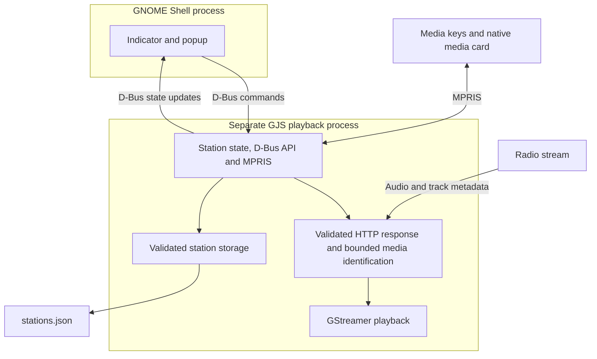

# Development

See [contributor guidelines](../AGENTS.md) and [verification commands](TESTING.md).

## Architecture and ownership



The Shell UI owns widgets, focus, local filtering, and a cached state snapshot.
The separate GJS/GStreamer service owns playback, validation, persistence, source
loading, and metadata. State changes arrive through D-Bus signals rather than
polling. Core logic contains no Shell widgets; no other desktop adapter is shipped.
There is no web runtime, runtime Python/npm dependency, station-directory API,
recording, account system, or podcast subsystem.

| Location | Responsibility |
| --- | --- |
| [extension/](../extension/) | Native popup/indicator, symbolic SVGs, layout CSS, desktop adapter. |
| [src/core/](../src/core/) | URL/config validation, bounded playlist/image parsing, metadata sanitization and deduplication. |
| [src/core/validation/](../src/core/validation/) | Shared URL/redirect, configuration schema/text, and bounded byte-level audio/container admission policy. |
| [src/service/](../src/service/) | GStreamer, async playlists/favicons, atomic storage, D-Bus/MPRIS, process-local resource policy. |
| [radio.xml](../src/service/radio.xml) | App command/state contract; `State` is JSON in a D-Bus string property. |
| [tests/unit/](../tests/unit/) | Critical validation, metadata, parsing, and storage cases. |
| [tests/e2e/](../tests/e2e/) | Production service and actual Shell workflows using local fixtures. |
| [scripts/](../scripts/), [Makefile](../Makefile), [Dockerfile](../Dockerfile) | Contained builds, tests, packaging, and live-development helpers. |

### Lifecycle and cancellation

`enable()` loads owned styles, creates the indicator, and starts the service.
`disable()` destroys UI/subscriptions, unloads its stylesheet, and requests service
shutdown without blocking Shell. Service teardown handles SIGTERM/SIGINT and loss
of its owning Shell D-Bus connection. Infobox Stop exits the backend; subsequent
Play or station/settings operations start it on demand. An unexpected service
exit preserves the indicator for explicit retry, with stale metadata cleared.
Screen lock follows GNOME's default `user` session mode: stop on lock, idle on unlock.

UI call generations/cancellables prevent stale replies from updating removed UI
or undoing a newer Stop. Service load generations/cancellables prevent a slow
playlist or obsolete source from starting after a switch, edit, Pause, or Stop.
Track every actor, subscription, timeout, request, and process through its owner
and cleanup path. Keep the focused playback input target intact during a pending
command; the command guard suppresses duplicates without interrupting native gestures.

The two-minute service-readiness deadline accommodates cold GStreamer discovery;
child exit fails promptly and Stop/Quit can cancel startup. Stream connection or
rebuffering uses a cancellable 30-second one-shot deadline, not a recurring timer.
The service entry retains its standalone `#!@GJS@ -m` marker and runs with `gjs -m`.

### Stream validation and decoder boundary (Unreleased)

Validation acts on URLs, redirect destinations, and initial response bytes. The
pure policies live in `src/core/validation/`; they have no Shell or GStreamer
dependency. `http.js` enforces redirect policy on actual libsoup requests;
`source.js` resolves bounded playlists and inspects up to 64 KiB through a native
`Gio.BufferedInputStream`. No extension-based playback shortcut or second GET
is used. HTTPS sources cannot fall back to HTTP, including through playlist entries.

`decoder.js` builds explicit pipelines from fixed, owned element names after
admission. Native `giostreamsrc` consumes the same inspected buffer/response;
ICY/ID3 handling and supported container parsers precede an allowed audio decoder.
There is no `playbin`/`decodebin`, decoder autoselection, media URI reopening,
video output, or JavaScript callback from a streaming thread. Codec alternatives
are explicitly enumerated; missing native components fail with a codec error.
MP4 headers are inspected for audio tracks and supported sample descriptions;
WAV is limited to PCM/float and Ogg to the allowed audio codecs.

Stop first aborts HTTP I/O, then stops the native pipeline and closes the stream.
Failed/stale loads close their response; generation guards and one-shot deadlines
remain in effect. This is bounded admission plus native format parsing, not a
proof that a malformed allowed format cannot exploit a native library bug.

### Desktop integration and identity

Use native Shell fonts, colors, focus, and light/dark styles; CSS controls compact
layout rather than replacing theme colors. The popup is fixed-width, with a
font-relative fixed-height infobox and mutually exclusive lower views. Keep URLs
in the editor, metadata subdued, row actions available to keyboard users, and
internal actions inside the open popup. Update MPRIS silently; legacy notification
fields remain compatible but never trigger song-change banners.

The indicator stays standalone unless an explicitly compatible cooperative group
exists. Never reparent arbitrary app indicators. Theme cleanup removes distinct,
identifiable styles only from this extension's directory, preserving the shared
Shell theme object, other styles, and unidentified registrations. Versioned CSS
and content-addressed UI modules support live updates; native GType identities
include the module URI so cached installations cannot collide.

Keep UUID `radiolina@drdaniloromano.github.io` stable. Service identifiers
`org.mpris.MediaPlayer2.GnomeRadio` / `org.gnome.Radio1` and the `gnome-radio`
config/cache names deliberately retain compatibility. Stable station IDs preserve
selection/history through edits. Storage validates before private atomic replacement;
unreadable existing configuration blocks mutations rather than destroying data.
Clipboard access writes only the editor URL; it does not read clipboard contents.

## Dependencies and codecs

Container development keeps tools contained; it does not make the extension ZIP
self-sufficient. The installed Shell UI and GJS service load the desktop host's
libraries and GStreamer plugins. None of those native libraries are bundled in
the ZIP or installed onto the host by the build scripts.

| Use | Required components | Where they must exist |
| --- | --- | --- |
| Installed extension | GNOME Shell 49; GJS and GI bindings for GLib/Gio/GLibUnix, GStreamer 1.x, and libsoup 3; session D-Bus and desktop audio. Shell supplies St/Clutter/Pango. | Desktop host. |
| Playback | Native GIO source, audio conversion/resampling/volume, buffering, and an available audio sink; parser/decoder for the chosen format. Base/Good plugins cover the verified common set, with AAC exceptions below. | Desktop host; a silent sink replaces desktop audio in tests. |
| Container packaging | Make, POSIX shell/basic user-ID tools, local Podman or Docker; network access for image creation. Python and development packages come from [Dockerfile](../Dockerfile). | Host needs the engine/Make, not the image's GJS/Python libraries. |
| Direct packaging (`make build`) | Python 3 standard library; Make for the convenience target. No GJS/media stack is needed just to create the ZIP. | Existing host tools; no dependency installation. |
| Service/media tests (`make test`) | Runtime GJS/GI/GStreamer/libsoup plus Python 3, PyGObject, `dbus-run-session`, GStreamer command-line tools/fixture encoders, and OpenSSL. | Development image for `make container-test`; existing host tools for direct testing. |
| Shell tests | Native GNOME Shell 49 with headless rendering, Python/GI, service-test tools, and extension-management tools. | Disposable headless session or VM; the development image does not provide a full desktop. |

Python, Make, container engines, fixture encoders, and the OpenSSL command are
development tools, not installed-extension runtime dependencies. OpenSSL generates
temporary TLS-test certificates; tests trust their private CA only in a disposable
service copy and leave system trust unchanged. Optional favicon fetching is off
by default and uses native Shell image loading; additional codecs are needed only
for the formats you play. Packaging does not verify a destination PC's runtime.

### Per-format native elements

These are the explicit choices in [decoder.js](../src/service/decoder.js), not all
formats GStreamer might otherwise support. Package/plugin availability varies by
distribution; a missing decoder produces an error rather than an automatic install.

| Audio format/container | Required parser/decoder elements |
| --- | --- |
| MP3 | `mpegaudioparse` plus `mpg123audiodec`, `avdec_mp3`, or `mad`; preferred parser/decoder are in Good plugins. |
| AAC (ADTS/ADIF or admitted MP4 audio) | `aacparse` **and** one of `avdec_aac`, `fdkaacdec`, or `faad`. The parser alone cannot decode audio. |
| Ogg Vorbis | `oggdemux` plus `vorbisdec` or `avdec_vorbis`; the preferred pair is in Base plugins. |
| Ogg Opus | `oggdemux` plus `opusdec` or `avdec_opus`; the preferred pair is in Base plugins. |
| FLAC | `flacparse` plus `flacdec` or `avdec_flac`; add `oggdemux` for Ogg FLAC. Preferred native elements are in Good plugins. |
| PCM/float WAV | `wavparse` (Good), followed by raw-audio conversion; no compressed-audio decoder. |
| Audio-only MP4/M4A | `qtdemux` (Good), plus the parser/decoder of its admitted embedded codec; the `.m4a` extension alone does not establish AAC or decoder availability. |

All pipelines also use `giostreamsrc`, `queue2`, `audioconvert`, `audioresample`,
`volume`, and `autoaudiosink` with a working output backend. ICY and ID3 streams
add `icydemux` and `id3demux`. Tests use `fakesink`; silent decoding does not verify
the host's actual output device.

AAC is an important distinction: [aacparse](https://gstreamer.freedesktop.org/documentation/audioparsers/aacparse.html)
is in Good, whereas [avdec_aac](https://gstreamer.freedesktop.org/documentation/libav/avdec_aac.html)
comes from libav, and [fdkaacdec](https://gstreamer.freedesktop.org/documentation/fdkaac/index.html)
or [faad](https://gstreamer.freedesktop.org/documentation/faad/index.html) come from
Bad plugins. The current Fedora image provides the parser but none of these AAC
decoders: its tests establish missing-codec handling, not positive AAC playback.
An eligible decoder on the desktop host is required even when container packaging succeeds.

Inspect actual availability with already installed tools, for example
`gst-inspect-1.0 mpg123audiodec` or `gst-inspect-1.0 avdec_aac`; a missing factory
means that decoder is unavailable. See [format restrictions](USER_GUIDE.md#stream-formats-and-saved-data)
and [test coverage](TESTING.md#automated-coverage).

### Verified versions, not minimum-version claims

The Fedora 43 image was verified with GJS **1.86.0**, GLib **2.86.5**,
GStreamer/Base/Good **1.26.11**, and libsoup **3.6.6**. Development tools included
Python **3.14.8**, Make **4.4.1**, OpenSSL **3.5.9**, D-Bus **1.16.2**, and Podman
**5.8.4**. Headless Shell workflows have passed on GNOME **49.7** and **49.8**;
earlier GNOME **49.1** VM workflows have maintainer confirmation. Genuine Docker runtime remains untested here;
the available `docker` command delegates to Podman.

GNOME Shell **49** is the declared target. Lower GJS/GLib/GStreamer package
minimums have not been established by a compatibility matrix; the verified
versions above are examples, not proven minimums. GI namespace versions such as
`Gst-1.0` and `Soup-3.0` identify APIs rather than the exact installed package release.

## Contained builds and configuration

With Podman or Docker, and Make already installed (Linux, local engine):

```sh
make container-build
make container-test
make container-package
```

Podman is the default; select Docker explicitly for each command:

```sh
make container-build CONTAINER_ENGINE=docker
make container-test CONTAINER_ENGINE=docker
make container-package CONTAINER_ENGINE=docker
```

Development packages stay in the Fedora 43 image defined by [Dockerfile](../Dockerfile).
Building the image needs network access. [.dockerignore](../.dockerignore), supported
by both engines, excludes everything except the recipe and ignore file from the
build context; the image contains dependencies rather than a copy of the checkout.
Tests and packaging run offline with only `extension/`, `src/`, `scripts/`, `tests/`,
and `LICENSE` mounted read-only. Private `workspace/`, Git metadata, credentials,
and the rest of the checkout are not mounted. Packaging alone mounts host-created
`build/` writable and writes `build/radiolina@drdaniloromano.github.io.zip`.

[Identity selection](../scripts/container-user-flags.sh) detects the actual CLI,
including Docker commands backed by Podman. Podman uses `--userns=keep-id`.
Rootful Docker uses the caller's numeric UID/GID with `--userns=host` to avoid
daemon remapping; rootless Docker uses container UID/GID 0, mapped to its host
user. Run rootless Docker as the same user who owns the checkout. See Docker's
[UID/GID mapping](https://docs.docker.com/engine/security/rootless/uid-gid-mapping/).
No `sudo`, host `chown`, or checkout relabeling is needed; the containers use
`--security-opt label=disable` for SELinux bind-mount access. Remote daemons and
Docker Desktop are outside this local-Linux workflow's verification scope.

Build/test commands do not install the extension on your desktop. The ZIP contains
runtime source, interfaces, icons, metadata, CSS, and LICENSE, excluding repository
docs and development/private files. Rebuild the image after changing Dockerfile;
ordinary source edits are visible through the explicit read-only mounts.

`make build` and `make test` use already installed host tools without installing
anything; their different requirements are listed in the [dependency table](#dependencies-and-codecs).

| Make variable | Default | Meaning |
| --- | --- | --- |
| `CONTAINER_ENGINE` | `podman` | `podman` or `docker`; runtime identity flags adapt to the actual engine. |
| `IMAGE` | `localhost/gnome-radio-dev:43` | Development image tag. |
| `OOM_SCORE_ADJ` | `500` | Playback-service kernel adjustment: integer 0–1000, or `inherit`. |

```sh
make build OOM_SCORE_ADJ=750
make container-package OOM_SCORE_ADJ=inherit
python3 scripts/build.py --oom-score-adj 750
```

The builder generates the packaged [build-config.js](../src/service/build-config.js)
without changing the source default; invalid values fail before replacing artifacts.
Only [resource-policy.js](../src/service/resource-policy.js), imported by the
service entry, writes `/proc/self/oom_score_adj` once. Shell's score is unchanged.
Missing/denied controls log a warning and leave playback operational. `inherit`
leaves the inherited adjustment intact. This sets a kernel preference, not a
universal kill order: other managers such as [systemd-oomd](https://www.freedesktop.org/software/systemd/man/latest/systemd-oomd.service.html)
use their own policies. There is no system-wide OOM setting or daemon dependency.
See [OOM verification and limitations](TESTING.md#oom-isolation-and-crash-recovery).

## Input and resource bounds

| Input | Bounds and behavior |
| --- | --- |
| Configuration | 1 MiB UTF-8 JSON; bounded reads stop after one overflow byte before parsing, without relying on a size check. Reject unknown top-level/station fields; publish only explicit schema fields. Private atomic writes use the same validation/byte limit. Invalid files remain untouched and service mutations stay blocked until repair/restart. |
| Stations | Up to 200; names up to 80 characters; unique ASCII IDs up to 128 characters and HTTP(S) URLs up to 2,048 characters without credentials/fragments. |
| Playlists | 256 KiB, three documents, five redirects, 15-second resolution deadline; first usable HTTP(S) entry. Reject circular sources, HLS, and XML declarations/DTDs. |
| Audio identification | 64 KiB prefix, within the 15-second source-loading deadline; explicit audio container/codec policy, with no second audio GET. ID3/MP4 headers must fit; MP4 must be streamable. |
| Favicons | Origin `/favicon.ico`, sequential host-deduplicated requests, PNG/ICO only, 256 KiB and bounded dimensions, three redirects, five seconds; cached, cancellable, no refresh polling. |
| Recent | Ten retained unique played stations; 1–10 shown, default three. Lowering the display limit preserves history. |

Configuration schema/defaults live in
[validation/config.js](../src/core/validation/config.js); Store owns bounded I/O.
The existing `stations.js` exports remain compatible. Version-1 files can omit
newer optional settings; accepted configs are copied into known-field objects.
These Unreleased limits constrain local configuration allocation and IPC, not
remote media attacks or malicious same-user processes. Oversized State propagation
was reproduced before the fix; no memory-exhaustion or Shell crash was attempted.

Resource samples are service-only, not the incremental memory used inside Shell.
Before validation hardening, an offline-container idle sample measured 36.9 MiB RSS and 0.000 CPU seconds over
one second. A paused local-fixture sample measured 46.9 MiB RSS / 41.4 MiB PSS and
0.000 CPU seconds over 10.002 seconds; MPRIS Stop retained about 47.0 MiB RSS.
Infobox Stop instead exits that process. Shared libraries, allocator behavior,
streams, codecs, and audio sinks affect results; these are observations, not budgets.

The validation branch's offline suite also measured idle RSS 36.9 MiB with 0.000
CPU seconds over one second. A separate paused ICY fixture measured 49.0 MiB RSS /
43.4 MiB PSS with 0.000 CPU seconds over five seconds. Finite playback-cycle probes
showed native descriptors being reclaimed after idle/diagnostic GC in a disposable
copy; no production GC timer was added and long-duration leak freedom is not established.

## URL privacy and diagnostics

MPRIS omits `xesam:url` entirely, including for public streams: secrets can occur
in paths as well as query strings. Keep track IDs, station/title/artist and media
controls; the [MPRIS metadata contract](https://specifications.freedesktop.org/mpris/latest/Player_Interface.html#Property:Metadata)
requires a track ID, not a URL. The playback response owns its final URL internally;
the application `State` no longer exports `resolvedUrl`.

[UserError/publicErrorMessage](../src/core/errors.js) marks code-authored public
messages and sanitizes/bounds them to 384 characters. Never put URLs, server text,
user input or a native error's message into `UserError`. Boundary handlers replace
unexpected/native errors with fixed fallbacks. Playback and optional-icon warnings
also use fixed messages; codec/HTTP-status/validation guidance remains specific.
No raw-error opt-in logger or polling is introduced. External native debugging is
outside this policy and its output must be reviewed before sharing.

Full saved URLs remain necessary for station editing/Copy and are exposed in
station-management state and private plaintext storage. This reduces unnecessary
metadata/diagnostic disclosure; it is not a boundary against same-user processes.
See [user-facing privacy limits](USER_GUIDE.md#url-privacy).

## Release policy

The current local release is **0.3.0**; public distribution is pending.
Use `MAJOR.MINOR.PATCH`:
patches for fixes, minor increments for features/compatibility breaks during `0.x`,
and major increments for compatibility breaks after `1.0`. Set `version-name` in
[metadata.json](../extension/metadata.json); leave numeric submission versions to
[extensions.gnome.org](https://gjs.guide/extensions/overview/anatomy.html#version-name).

For a finalized release, date the changelog entry, tag the reviewed commit
`v{release}` (for example `v0.3.0`), build its ZIP, and record the checksum. A planned
version or Unreleased entry creates neither a tag nor a public release. Keep original
MIT notices in the package; platform dependencies retain their own licenses.
Retain the [provenance findings and review limits](PROVENANCE.md).
